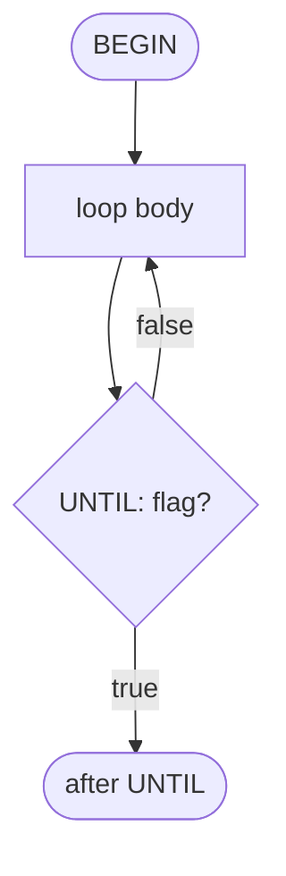
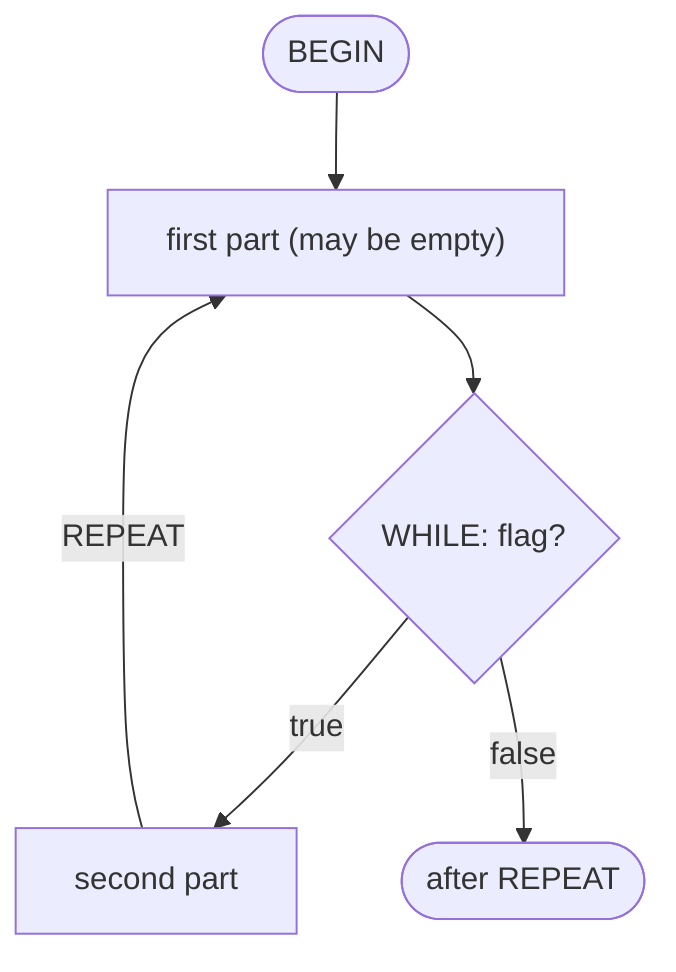
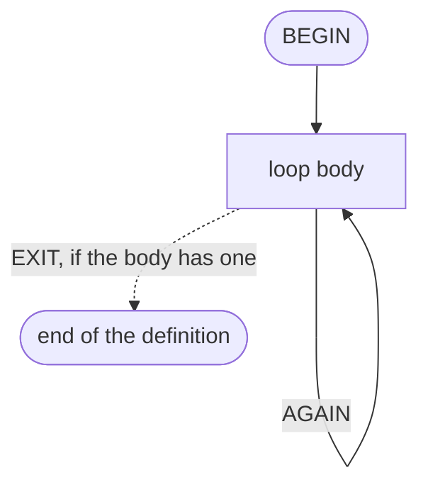

# From NextBASIC to vForth

A migration guide for programmers who know NextBASIC and want to move to
vForth, the Forth system for the ZX Spectrum Next.

> **Draft.** Only the pilot chapter (Chapter 3, Looping) is written. It fixes
> the form and the tone of every other chapter; the plan is in
> `planners/BASIC-TO-FORTH-PLAN.md`.

## How to read this guide

The guide follows the table of contents of the *ZX Spectrum Next User Manual*,
third edition: one chapter here for each chapter there, with the same number
and title. References such as "p. 21" are page numbers of that manual's PDF.
The manual itself is not quoted: keep it open next to this guide.

Every chapter has the same six parts:

1. **In short** -- how much of the chapter carries over.
2. **What changes** -- where the Forth model differs from the BASIC one.
3. **Correspondence table** -- BASIC on the left, vForth on the right.
4. **Side by side** -- a few short programs in both languages.
5. **No equivalent** -- what vForth does not offer, and why.
6. **Further reading** -- tutorials, help entries, vForth manual sections.

Conventions used in the listings:

- The BASIC listings are written for this guide; they are not taken from the
  manual.
- In the Forth listings `\ => text` shows what the line prints. When the
  output takes several lines it follows the listing in a block of its own.
- `NEEDS name` loads a word that is not part of the core. Words used without
  a `NEEDS` are always available.
- Every Forth listing is typed into vForth and checked by
  `emu/test_basic_guide.py`, except those that wait for a key or never end.
- Type the Forth listings in order: later ones may use earlier definitions.

---

## Chapter 3 - Looping

Manual: Chapter 3, pp. 21-26.

### In short

Everything in this chapter carries over. `FOR ... NEXT` becomes `DO ... LOOP`,
`STEP` becomes `+LOOP`, `REPEAT ... REPEAT UNTIL` becomes `BEGIN ... UNTIL`,
`WHILE` keeps its name and `EXIT` becomes `LEAVE`. What you have to relearn is
small but easy to trip over: where the limit goes, whether the limit is
included, and the fact that the loop counter is not a variable.

### What changes

**Loops live inside definitions.** BASIC lets you type a `FOR` loop as a
direct command. Forth loop words only work while a definition is being
compiled, so a loop is always part of a word, even a throwaway one:

```forth
5 0 DO I . LOOP                 \ => DO? Can't be executed.
: FIVE  5 0 DO I . LOOP ;
FIVE                            \ => 0 1 2 3 4
```

**The limit comes first, and it is not included.** `FOR i=1 TO 5` names the
start, then the last value. `DO` takes the limit, then the start, and stops
*before* the limit: `FOR i=1 TO 5` is `6 1 DO`. The usual Forth habit is to
count from zero, where this reads naturally: `5 0 DO` runs five times, with
the counter going from 0 to 4.

**The counter is not a variable.** There is no control variable to name, so
`NEXT` needs no name either: `LOOP` always closes the nearest `DO`. Inside the
loop the word `I` pushes the current counter on the stack. After the loop the
counter is gone; BASIC's habit of reading the control variable once the loop
has ended (where it holds the first value past the limit) has no counterpart.
If you need the value at which a loop stopped, leave it on the stack before
you get out.

**The counter is a 16-bit integer.** NextBASIC's fast integer loops
(`FOR %i=...`) are the only kind Forth has. A step such as `STEP 0.5` has to
be rescaled to whole numbers (see "No equivalent"). The counter wraps around
at 65536, so a loop can also run over unsigned values or addresses above
32767; print those with `U.` instead of `.`.

**`DO` always runs at least once.** `FOR i=1 TO 0` does nothing in BASIC. In
Forth the test is at the bottom, in `LOOP`, and a `DO` whose start equals its
limit goes all the way round: 65536 turns. Whenever the count may be zero use
`?DO`, which skips the loop when start and limit are equal:

```forth
: STARS  ( n -- )  0 ?DO  ." *"  LOOP ;
3 STARS                         \ => ***
0 STARS                         \ prints nothing
```

`?DO` only catches *equal*. A start already past the limit still wraps around
(`1 5 ?DO` runs 65532 times), so clamp a count that may be negative:

```forth
: STARS  ( n -- )  0 MAX  0 ?DO  ." *"  LOOP ;
-3 STARS                        \ prints nothing
```

**Counting down includes the limit.** With a negative step the loop ends when
the counter passes *below* the limit, so the limit itself is used:
`FOR n=10 TO 1 STEP -1` is `1 10 DO ... -1 +LOOP`, with no adjustment. Only
the upward direction needs the `1+`.

**`EXIT` means something else.** BASIC's `EXIT` leaves the loop. Forth's
`EXIT` leaves the *whole definition*, like `ENDPROC` or `RETURN`. The word
that leaves a `DO` loop is `LEAVE`. And since `DO` keeps counter and limit on
the return stack, `EXIT` from inside a `DO` loop must first discard them with
`UNLOOP`, once for each loop being abandoned. Forget it and the machine
crashes.

**`REPEAT` means something else too.** In BASIC `REPEAT` opens a loop. In
Forth the loop is opened by `BEGIN`, and `REPEAT` *closes* one particular
form of it (`BEGIN ... WHILE ... REPEAT`). The three forms are:

| Forth | Test | Runs |
|---|---|---|
| `BEGIN ... flag UNTIL` | at the bottom | until the flag is true, at least once |
| `BEGIN ... flag WHILE ... REPEAT` | where `WHILE` is | as long as the flag is true |
| `BEGIN ... AGAIN` | none | for ever |

`BEGIN ... flag UNTIL` -- the body always runs once, then the flag decides:



`BEGIN ... flag WHILE ... REPEAT` -- the flag is tested before the second
part, so that part may never run:



`BEGIN ... AGAIN` -- no test, so no way out except `EXIT`:



**BREAK is not automatic.** BASIC checks the BREAK key between statements.
A Forth loop runs until its own test says stop, so an endless loop with no
test can only be stopped by a reset. Any loop that might not end should poll
`?TERMINAL`, which returns true while BREAK is held down.

**Loops cannot overlap, and the compiler says so.** Two crossed
`FOR ... NEXT` loops fail when BASIC runs them. Forth checks the pairing when
it compiles, and refuses the definition:

```forth
: BAD  3 0 DO  I 1 = IF  LOOP  THEN ;   \ => LOOP? Syntax error.
```

For the same reason there is no jumping into the middle of a loop: there is
nothing to jump with.

### Correspondence table

| NextBASIC | vForth | Note |
|---|---|---|
| `FOR v=a TO b` ... `NEXT v` | `b 1+ a DO` ... `LOOP` | Limit first, then start; the limit is excluded. |
| the same, when it may run zero times | `b 1+ a ?DO` ... `LOOP` | `?DO` skips the loop when start = limit. |
| `FOR v=a TO b STEP s` (s > 0) | `b 1+ a DO` ... `s +LOOP` | The step goes at the bottom and may change at each turn. |
| `FOR v=a TO b STEP -s` | `b a DO` ... `-s +LOOP` | Counting down, the limit is included. |
| `FOR %i=a TO b` | as above | Every Forth loop is a 16-bit integer loop. |
| `v` inside the loop | `I` | Counter of the innermost loop. |
| control variable of the outer loop | `J` | `NEEDS J`. One level further out: `K` (`NEEDS K`). |
| the limit `b` | `I'` | Pushes the limit of the innermost loop. |
| `EXIT` (from `FOR`) | `LEAVE` | Continues after `LOOP`. |
| `EXIT` (from `REPEAT`) | `WHILE`, or `EXIT` | `LEAVE` is for `DO` loops only. |
| `EXIT: EXIT` (two nested loops) | `UNLOOP UNLOOP EXIT` | `NEEDS UNLOOP`. Leaves the definition. |
| `ENDPROC` / `RETURN` inside a loop | `EXIT`; in a `DO` loop `UNLOOP EXIT` | |
| `REPEAT` ... `REPEAT UNTIL c` | `BEGIN` ... `c UNTIL` | Runs at least once. |
| `REPEAT: WHILE c` ... `REPEAT UNTIL 0` | `BEGIN c WHILE` ... `REPEAT` | May run zero times. |
| `WHILE c` in the middle | `BEGIN` ... `c WHILE` ... `REPEAT` | The same construct. |
| `REPEAT` ... `REPEAT UNTIL 0` | `BEGIN` ... `AGAIN` | Poll `?TERMINAL` or it never stops. |
| BREAK key | `?TERMINAL` | True while BREAK is pressed. |
| `EXIT n` (leave and jump to line n) | - | See "No equivalent". |

### Side by side

**Counting.** The sum of the numbers from 1 to 10.

```
10 LET s=0
20 FOR i=1 TO 10
30   LET s=s+i
40 NEXT i
50 PRINT s
```

```forth
: SUM-TO  ( n -- sum )
    0 SWAP              \ the running total, under n
    1+ 1 DO             \ from 1 to n: the limit is n+1
        I +
    LOOP ;
10 SUM-TO .             \ => 55
```

The total is not a variable: it sits on the stack, and each turn adds `I` to
it. The limit is not written in the program either; it is whatever number is
on the stack when `SUM-TO` is called.

**Steps.** Down from 10 to 1, then up from 1 in steps of 3.

```
10 FOR n=10 TO 1 STEP -1: PRINT n;" ";: NEXT n
20 PRINT
30 FOR n=1 TO 9 STEP 3: PRINT n;" ";: NEXT n
```

```forth
: DOWN    1 10 DO  I .  -1 +LOOP ;
: BY-3   10  1 DO  I .   3 +LOOP ;
DOWN                    \ => 10 9 8 7 6 5 4 3 2 1
BY-3                    \ => 1 4 7
```

**Nested loops.** A small multiplication table.

```
10 FOR r=1 TO 3
20   FOR c=1 TO 4
30     PRINT r*c;" ";
40   NEXT c
50   PRINT
60 NEXT r
```

The literal translation uses `J` for the outer counter:

```forth
NEEDS J
: TABLE  ( -- )
    4 1 DO
        5 1 DO  J I * 3 .R  LOOP
        CR
    LOOP ;
TABLE
```

```text
  1  2  3  4
  2  4  6  8
  3  6  9 12
```

The Forth habit is to give the inner loop a name of its own. Each word then
has one loop, `I` is the only counter in sight, and `ROW` can be tried alone:

```forth
: ROW  ( r -- )
    5 1 DO  DUP I * 3 .R  LOOP
    DROP CR ;
: TABLE  ( -- )
    4 1 DO  I ROW  LOOP ;
2 ROW                   \ => 2 4 6 8
```

**Leaving early.** Print the squares, but stop at the first one above 50.

```
10 FOR i=1 TO 20
20   IF i*i>50 THEN EXIT
30   PRINT i*i;" ";
40 NEXT i
50 PRINT "done"
```

```forth
: SQUARES  ( -- )
    21 1 DO
        I I * 50 > IF  LEAVE  THEN
        I I * .
    LOOP
    ." done" ;
SQUARES                 \ => 1 4 9 16 25 36 49 done
```

**Leaving two loops at once.** Find two numbers from 1 to 9 whose product is
a given number.

```
10 LET p=42
20 FOR a=1 TO 9
30   FOR b=1 TO 9
40     IF a*b=p THEN PRINT a;" ";b: EXIT: EXIT 80
50   NEXT b
60 NEXT a
70 PRINT "none"
80 REM continue here
```

```forth
NEEDS J
NEEDS UNLOOP
: FACTORS  ( p -- )
    10 1 DO
        10 1 DO
            J I * OVER = IF
                DROP  J . I .
                UNLOOP UNLOOP EXIT
            THEN
        LOOP
    LOOP
    DROP ." none" ;
42 FACTORS              \ => 6 7
97 FACTORS              \ => none
```

`EXIT` ends `FACTORS` there and then, which is exactly what the line number
after BASIC's second `EXIT` was for: skipping the "none". Note the two
`UNLOOP`s, one for each loop left behind, and the `DROP` on both ways out so
that `p` does not stay on the stack.

**Test at the bottom.** How many times can 1000 be halved before it
reaches zero?

```
10 LET n=1000: LET c=0
20 REPEAT
30   LET n=INT (n/2): LET c=c+1
40 REPEAT UNTIL n=0
50 PRINT c
```

```forth
: HALVINGS  ( n -- count )
    0 SWAP              \ count, under n
    BEGIN
        2/  SWAP 1+ SWAP
        DUP 0=
    UNTIL
    DROP ;
1000 HALVINGS .         \ => 10
```

**Test at the top.** The same count, but zero must give zero: the test has to
come before the first halving.

```
10 LET n=1000: LET c=0
20 REPEAT: WHILE n>0
30   LET n=INT (n/2): LET c=c+1
40 REPEAT UNTIL 0
50 PRINT c
```

```forth
: HALVINGS  ( n -- count )
    0 SWAP
    BEGIN  DUP 0>  WHILE
        2/  SWAP 1+ SWAP
    REPEAT
    DROP ;
1000 HALVINGS .         \ => 10
0 HALVINGS .            \ => 0
```

BASIC builds this loop from a `REPEAT UNTIL 0` that never ends plus a `WHILE`
that gets out of it. In Forth `BEGIN ... WHILE ... REPEAT` is one construct,
and the `WHILE` may stand anywhere between the other two words.

**For ever, until BREAK.**

```
10 REPEAT
20   PRINT "Hello ";
30 REPEAT UNTIL 0
```

<!-- no-test -->
```forth
: HELLO  ( -- )
    BEGIN
        ." Hello "
        ?TERMINAL
    UNTIL ;
```

`BEGIN ... AGAIN` is the literal translation of `REPEAT UNTIL 0`, but with it
nothing would ever stop `HELLO`. Using `?TERMINAL` as the `UNTIL` flag gives
back the BREAK key.

### No equivalent

- **Fractional steps.** `FOR x=0 TO 1 STEP 0.25` has no direct form. Scale
  the counter to whole numbers and divide when the value is used:
  `101 0 DO ... 25 +LOOP` counts in hundredths. Tutorial 064 shows the
  technique; tutorial 024 covers the floating-point library for the cases
  where scaling is not enough.
- **`EXIT n`.** There are no line numbers to jump to. What the jump is used
  for -- skipping the code that follows a loop -- is done by `EXIT` (leave the
  word) or by an `IF` after the loop.
- **Reading the control variable after the loop.** The counter exists only
  between `DO` and `LOOP`. Copy `I` to the stack before `LEAVE`.
- **`NEXT` typed as a direct command**, to advance a stopped loop by one turn
  (exercise 5, p. 26): a Forth loop cannot be stopped half-way and resumed.
- **Error trapping inside loops** (p. 26) is not a property of loops in
  Forth: see Chapter 4 and tutorial 026 (`CATCH` and `THROW`).

### Further reading

- Tutorial `007` -- counted loops: `DO`, `LOOP`, `+LOOP`, `?DO`, `LEAVE`,
  `BOUNDS`.
- Tutorial `006`, sections 4-6 -- `BEGIN` with `AGAIN`, `UNTIL`, `WHILE`.
- Tutorial `012`, section 5 -- what not to do with the return stack inside a
  `DO` loop.
- Tutorial `032` -- loops that poll `?TERMINAL`.
- `HELP DO`, `HELP ?DO`, `HELP LOOP`, `HELP +LOOP`, `HELP LEAVE`, `HELP UNLOOP`,
  `HELP BEGIN`, `HELP WHILE`, `HELP ?TERMINAL`.
- vForth manual, section 2.12.7 "Flow control".
